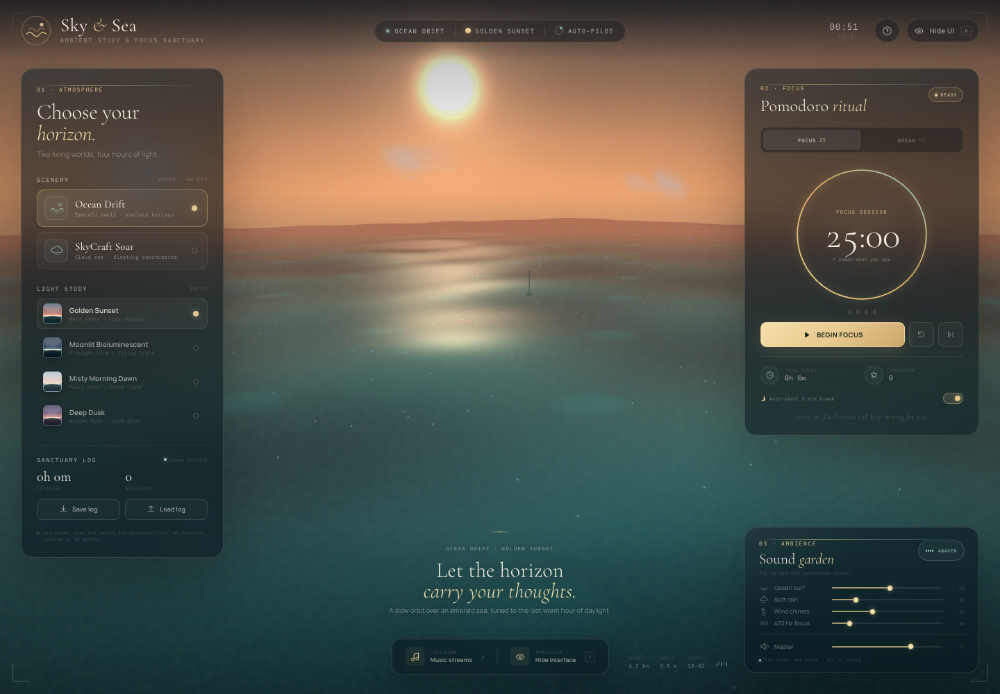
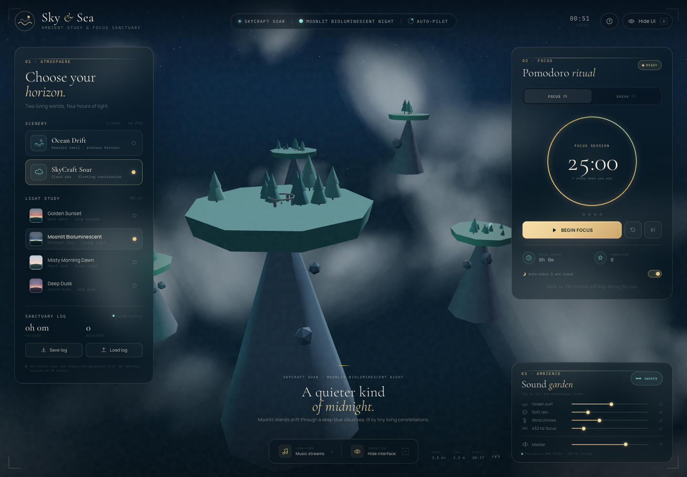
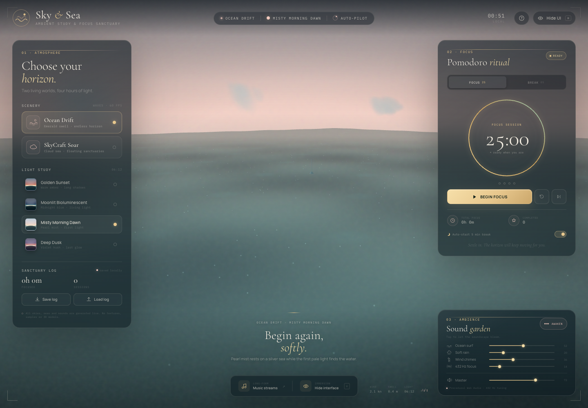
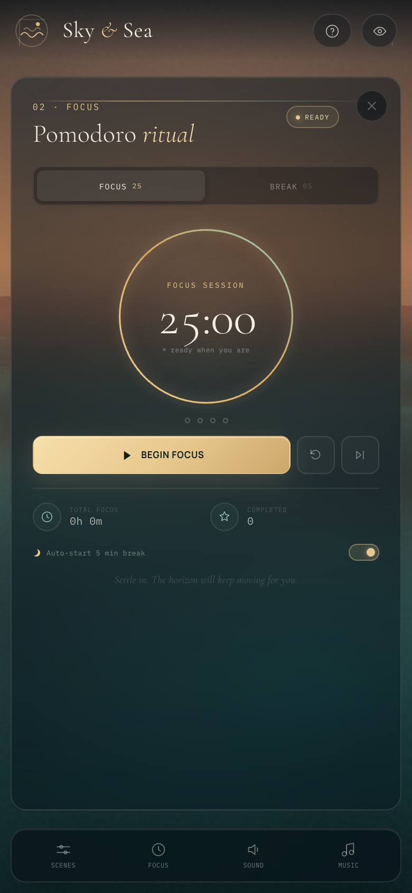
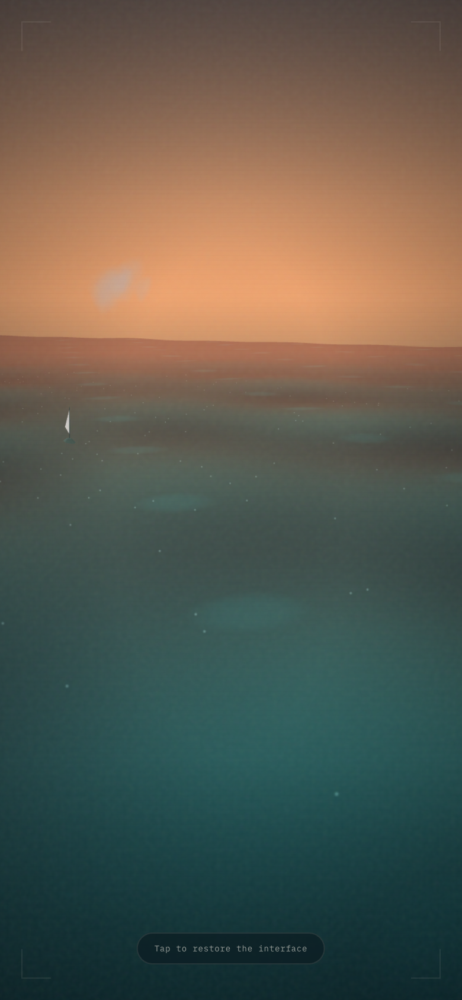

# Sky & Sea 3D

### Ambient Study & Focus Sanctuary

A single-page, no-build 3D study sanctuary that combines a procedural ocean and cloud world, a generated Web Audio soundscape, a Pomodoro ritual, long-form YouTube music, and a portable study log.

[**Live demo**](https://somphol.github.io/sky-and-sea-3d/) · [Features](#features) · [Run locally](#run-locally) · [Controls](#controls) · [Verification](#verification) · [Credits](#credits)



---

## What it is

Sky & Sea 3D is a distraction-free second-screen companion. The camera flies itself in a slow cinematic orbit, so the world keeps moving while you read, write, revise, or think. The interface stays out of the way until you need it.

Everything visual is generated at runtime with Three.js and custom GLSL. Every ambient sound is synthesized with the Web Audio API. There are no image textures, 3D model files, audio samples or build tools in the repository.

- **No build step** — plain HTML, CSS and ES6 JavaScript.
- **No backend** — study history lives in `localStorage` and can be exported as JSON.
- **No media downloads** — music is optional and plays through YouTube's own embed player.
- **No mandatory input** — the auto-pilot camera and atmosphere run immediately.

## Features

### 1. A living 3D world

**🌊 Ocean Drift**
- A 760 × 760 procedural water plane with 170 × 170 segments.
- Custom vertex shader combines five overlapping wave fields.
- Custom fragment shader adds wave normals, Fresnel sky reflection, sun and moon glints, crest foam, distance haze, and bioluminescent plankton light.
- A small sailboat, drifting horizon clouds, stars, sun/moon sprites and a fog-bound horizon give the scene depth.

**☁️ SkyCraft Soar**
- Volumetric-style cloud banks built from layered procedural canvas sprites.
- A sea of cloud below five floating terrain islands.
- Low-poly island rock cones, grass caps, pine forests, ruins, floating shards and glowing crystals.
- A flock of birds and a slow, high-altitude orbit around the islands.

**Four atmosphere studies**
- 🌅 **Golden Sunset** — amber light, long reflections, warm horizon.
- 🌌 **Moonlit Bioluminescent Night** — deep blue, moon glow, living cyan water.
- 🌄 **Misty Morning Dawn** — pearl fog, pale first light, silver sea.
- 🌇 **Deep Dusk** — violet hush, fading rose, early stars.

Preset changes interpolate the fog, hemisphere light, sun colour, sky gradient, water uniforms, star opacity, cloud tint and exposure over 2.2 seconds.

**Cinematic auto-pilot**
- The camera follows a slow elliptical orbit with gentle vertical drift and a smoothed look target.
- No input is required. Drag or scroll on the scenery to take manual control; the auto-pilot resumes after nine seconds.
- Both scenery modes carry their own camera path and orbit speed.

### 2. Ambient sound garden

The mixer has four independently synthesized layers plus a master channel:

| Layer | Synthesis |
| --- | --- |
| **Ocean surf** | Looping brown noise through high/low-pass filters, with two slow LFOs for swell and undertow |
| **Soft rain** | Filtered white noise with a gentle breathing LFO |
| **Wind chimes** | Randomly scheduled pentatonic sine chimes with overtones, stereo panning and 3–5 second decay tails |
| **432 Hz focus** | 432 Hz left / 438 Hz right binaural oscillators, a 6 Hz beat, and quiet sub-harmonics |
| **Master** | Compressor-limited gain stage with mute |

Volumes persist across reloads. Audio is intentionally dormant until the first gesture, as required by browser autoplay rules. The timer completion chime is a separate, gentle four-note phrase.

### 3. Pomodoro ritual

- 25-minute focus blocks and 5-minute breaks.
- Start, pause, resume, reset and skip controls.
- Accurate wall-clock countdown that survives tab throttling and reloads.
- Optional automatic break start.
- Four-session cycle dots.
- Gentle synthesized completion chime for both focus and break.
- Focus seconds are recorded as they happen; completed sessions are added to the study history.

### 4. Long-form music

The music drawer embeds available YouTube streams in a privacy-enhanced `youtube-nocookie.com` player:

- Lofi Girl — *beats to relax/study to* (2 h 50 m)
- Chillhop Music — live jazzy and lofi beats
- Lofi Girl — synthwave radio (live)
- Quiet Quest — 4 hours of ambient study music

There is also a paste-a-link field for any YouTube video, Short, live URL or 11-character video ID. Video availability and regional restrictions are controlled by YouTube.

### 5. Study log and portability

- `localStorage` key: `sky_and_sea_sanctuary_v1`
- Tracks total focus seconds, completed Pomodoros, session history, daily focus seconds, preferred scenery, preset, volumes, mute state and timer state.
- **Save log** downloads `focus_sanctuary_log.json`.
- **Load log** validates and restores a study log from another device or browser.
- Export includes a human-readable `totalFocusHours` alongside raw seconds.

### 6. Zen interface

- Glassmorphic panels with warm gold focus badges and a live atmosphere indicator.
- Responsive desktop, tablet and mobile layouts.
- Mobile bottom-sheet panels and a four-button dock.
- **Hide UI mode** — press `H`, the eye button, or *Hide interface* to remove every panel; the scenery continues.
- On touch devices, the floating “Tap to restore the interface” chip remains available.
- Auto-hiding cursor in hidden mode on desktop.
- Reduced-motion media query respected for interface animation.
- WebGL failure fallback keeps the timer, mixer and study log usable.

## Screenshots

| Ocean Drift · Golden Sunset | SkyCraft Soar · Moonlit Night |
| --- | --- |
|  |  |

| Ocean Drift · Misty Dawn | Mobile focus panel |
| --- | --- |
|  |  |



## Run locally

### Option A — open the file

Open `index.html` in a modern browser. An internet connection is needed for the Three.js CDN, Google Fonts and optional YouTube streams.

### Option B — local server (recommended)

```bash
cd sky-and-sea-3d
python3 -m http.server 8000
```

Then open <http://localhost:8000>.

There is nothing to install and nothing to build.

## Controls

| Input | Action |
| --- | --- |
| `H` | Hide / show the interface |
| `M` | Mute / unmute ambience |
| `Space` | Start / pause the Pomodoro timer |
| `O` | Toggle Ocean Drift / SkyCraft Soar |
| `1` `2` `3` `4` | Golden Sunset / Moonlit Night / Misty Dawn / Deep Dusk |
| `?` | Open the field guide |
| `Esc` | Close a modal or mobile panel, or restore the interface |
| Drag / scroll | Temporarily take manual camera control; auto-pilot resumes after 9 s |

Deep links are supported for sharing a starting atmosphere:

```text
https://somphol.github.io/sky-and-sea-3d/?scene=sky&preset=moonlit
https://somphol.github.io/sky-and-sea-3d/?scene=ocean&preset=dawn
```

## Study log format

`Save log` produces a JSON file like this:

```json
{
  "app": "sky-and-sea-3d",
  "appVersion": "1.0.0",
  "exportedAt": "2026-11-01T08:00:00.000Z",
  "stats": {
    "totalFocusSeconds": 7500,
    "totalFocusHours": 2.08,
    "completedPomodoros": 5,
    "sessions": [
      {
        "completedAt": "2026-10-31T10:00:00.000Z",
        "minutes": 25,
        "type": "focus"
      }
    ],
    "daily": { "2026-10-31": 1500 }
  },
  "preferences": {
    "scene": "sky",
    "preset": "moonlit",
    "volumes": {
      "ocean": 52,
      "rain": 20,
      "chimes": 36,
      "binaural": 14,
      "master": 72
    },
    "muted": false,
    "autoBreak": true
  },
  "timer": {
    "mode": "focus",
    "remaining": 1500,
    "running": false
  }
}
```

Imported values are sanitized and clamped before use. The timer is not overwritten by an import; only study history and atmosphere preferences are restored.

## Verification

The build was exercised in headless Chrome (WebGL via the headless renderer) and through the Chrome DevTools Protocol.

- **16/16** built-in self-tests pass. Open `?selftest=1` to run them in the browser console or run `SkySea.runSelfTests()`.
- **0** uncaught exceptions and **0** application console errors in the interaction run.
- Verified ocean and sky switching, all four presets, auto-pilot camera state, scene group visibility and finite camera coordinates.
- Verified timer start/pause, focus completion, stats increment, automatic break start and restored timer state.
- Verified synthetic audio graph construction, volume channel updates, mute state and persistence.
- Verified `focus_sanctuary_log.json` download and a real synthetic File import with sanitised stats and preferences.
- Verified keyboard shortcuts `H`, `2`, `O` and `Space`.
- Verified mobile layout at 390 × 844 with no horizontal overflow, four dock buttons, bottom-sheet panels and the touch-friendly restore chip.
- Verified the YouTube embed loads a long-form Lofi Girl mix in the player.

The built-in test surface covers state defaults, preset/scene counts, four audio channels, timer formatting, binaural configuration, YouTube ID parsing, export serialisation, localStorage availability, core DOM nodes, the Three.js renderer and auto-pilot camera state.

## Project structure

```text
sky-and-sea-3d/
├── index.html                  # Semantic interface, panels, modals, loader
├── style.css                   # Glassmorphic responsive design system
├── script.js                   # Scenery engine, audio engine, timer, storage, UI
├── favicon.svg                 # Hand-drawn brand mark
├── screenshot.png              # Desktop · Golden Sunset
├── screenshot-sky.png          # Desktop · SkyCraft moonlit
├── screenshot-dawn.png         # Desktop · Misty Dawn
├── screenshot-mobile.png       # Mobile · ambient view
├── screenshot-mobile-focus.png # Mobile · focus bottom sheet
├── screenshot-hidden.png       # Hide UI mode
├── README.md
├── LICENSE
├── THIRD_PARTY_NOTICES.md
├── STATE.md                    # Build timing, token usage and verification record
├── state.json                  # Machine-readable build record
└── .nojekyll                   # GitHub Pages static hosting
```

## Browser support

- Current Chrome, Edge, Firefox and Safari with WebGL enabled.
- Web Audio requires a user gesture before sound can start; this is normal browser policy.
- YouTube embeds may be unavailable in some regions, networks or privacy configurations.
- If WebGL is unavailable, the application shows a fallback and the timer, sound mixer and study log remain functional.

## Privacy

The application has no server and no analytics. Study data stays in the browser unless you export it. YouTube is only contacted when you open or play a music stream. Google Fonts and the Three.js CDN are loaded as static assets.

## Credits

Built with [**OpenCode**](https://opencode.ai) and **DeepSeek V4.1 Flash** (`opencode-go/deepseek-v4.1-flash`) in a single agent session. The scenery engine, shaders, island generation, interface, sound synthesis, timer, persistence and verification harness were created for this project.

Runtime libraries:

- [Three.js r128](https://threejs.org/) — MIT
- OrbitControls from the Three.js r128 examples — MIT
- Cormorant Garamond, Manrope and IBM Plex Mono via Google Fonts — SIL OFL 1.1

See [THIRD_PARTY_NOTICES.md](THIRD_PARTY_NOTICES.md) for details.

## License

[MIT](LICENSE) © 2026 Somphol Boonjing
